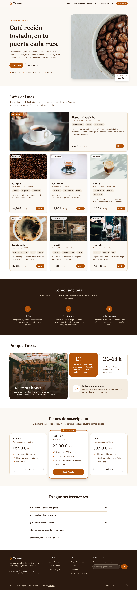
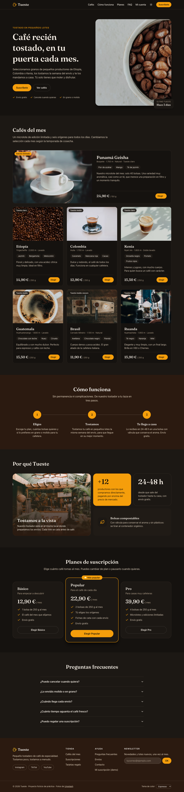
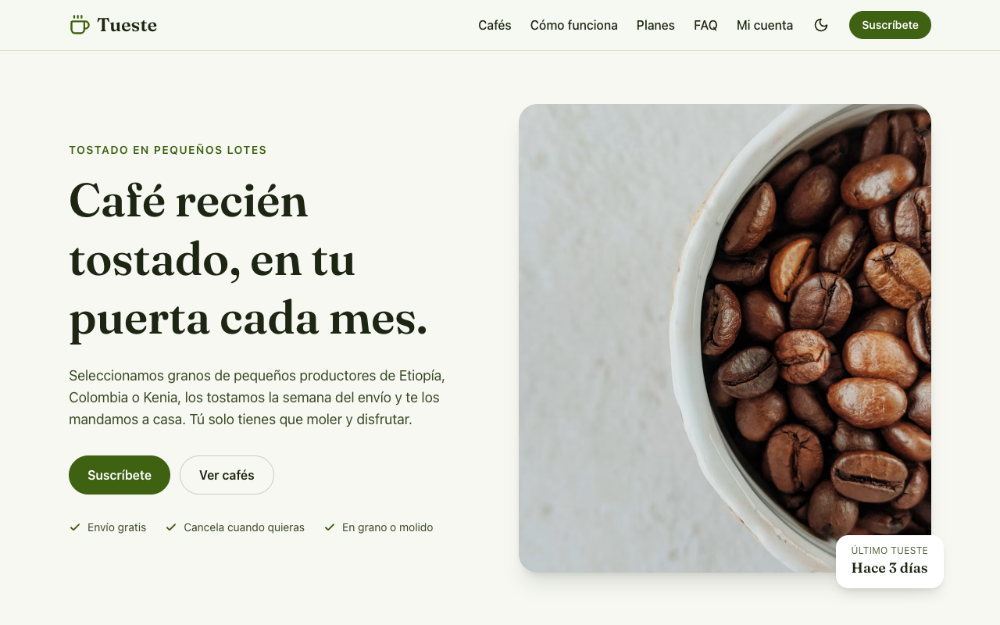
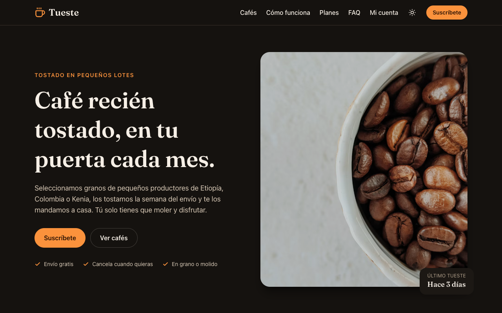
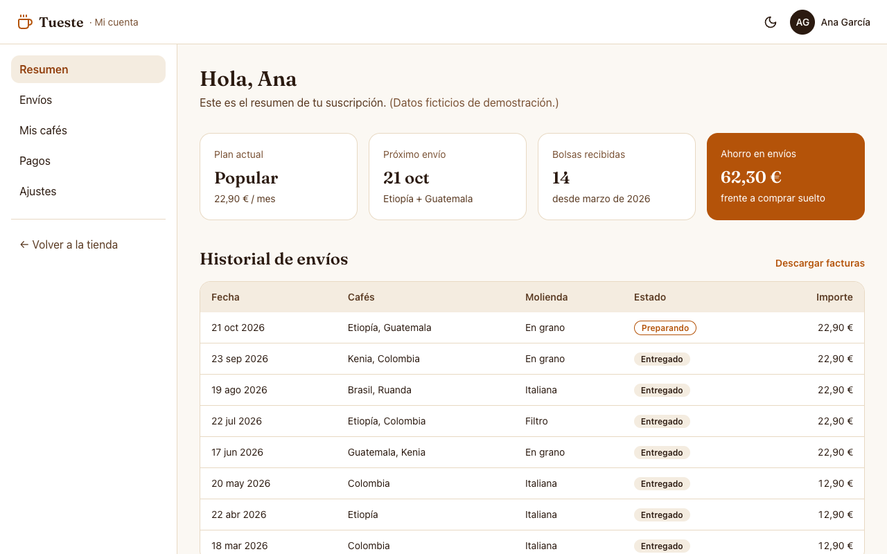
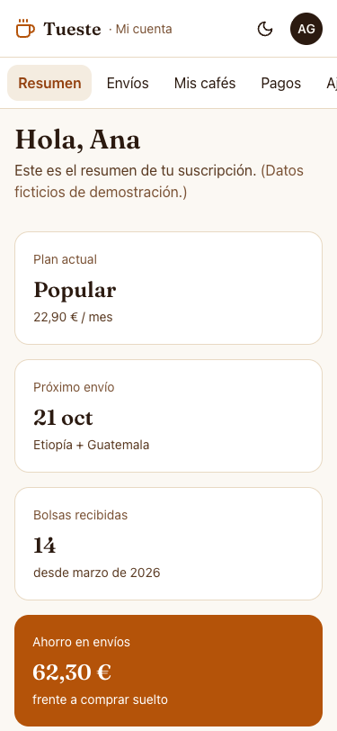

# Tueste · Laboratorio Módulo 01 (Layout + Tailwind CSS)

**Tema elegido: 🅰️ Tueste**, el tostadero de café de especialidad ficticio que vende por suscripción.

Landing page maquetada con HTML semántico y Tailwind CSS 4, mobile first, con modo oscuro y tres temas de color. Además: un panel de cliente (`panel.html`, desafío D5) y el ejercicio de captura a código (`d6/`, desafío D6).

| Móvil (375 px) | Escritorio (1280 px) | Escritorio, modo oscuro |
| --- | --- | --- |
|  |  |  |

| Tema "matcha" | Tema "caramelo" + oscuro | Panel (D5) escritorio | Panel (D5) móvil |
| --- | --- | --- | --- |
|  |  |  |  |

## Cómo arrancarlo

```bash
npm install
npm run dev      # servidor de desarrollo con recarga
npm run build    # comprobación de tipos + build en dist/
npm run preview  # sirve la build
```

Páginas: `/` (landing), `/panel.html` (panel de cliente), `/d6/despues.html` (desafío D6).

> El `.npmrc` del proyecto fija el registro público de npm por si vuestra configuración global apunta a un registro privado.

## Integración de Tailwind: Vite

Uso el plugin oficial **`@tailwindcss/vite`** (sobre el [boiler-tailwind](https://github.com/Lemoncode/boiler-tailwind) del curso):

- El proyecto ya usa Vite como servidor y bundler, así que el plugin se engancha directamente a su pipeline: no hace falta `postcss.config.js` ni ninguna configuración extra, y la recarga en caliente es inmediata.
- Es la opción que recomienda Tailwind 4 cuando el proyecto usa Vite. Es más rápida que pasar por PostCSS.
- **PostCSS** (`@tailwindcss/postcss`) tendría sentido si la herramienta de build no fuera Vite (webpack, algunos frameworks…). En v4 tampoco hace falta `autoprefixer`: Tailwind ya se encarga de los prefijos.

Toda la configuración está en el CSS (`src/style.css`): no hay `tailwind.config.js` (eso era la v3). `vite.config.ts` solo añade el plugin y declara las tres páginas de la build.

## Secciones de la landing

1. **Cabecera** fija con efecto cristal: logo, menú (hamburguesa sin JS en móvil), botón de modo oscuro y "Suscríbete".
2. **Hero**: titular, texto, botón principal y secundario, imagen con etiqueta flotante y animación de entrada.
3. **Cafés del mes**: una tarjeta destacada de edición limitada (horizontal gracias a una container query) y 6 tarjetas con imagen, origen, notas de cata, precio y botón.
4. **Cómo funciona**: tres pasos conectados con una línea.
5. **Por qué Tueste**: rejilla bento.
6. **Planes**: Básico, Popular (destacado) y Pro.
7. **Preguntas frecuentes** con `<details>` nativo.
8. **Pie** con 4 columnas, redes, newsletter con validación, selector de tema y copyright.

## Checklist

### ✅ Obligatorios

- [x] **O1 Estructura semántica**: `header`, `nav`, `main`, `section` con título, `article` en las tarjetas, `footer`; un solo `h1`; listas de enlaces en `ul`; `alt` descriptivo en el hero y `alt=""` en las fotos decorativas.
- [x] **O2 Tema con `@theme`**: marca `marca` (500/700/900) + acento `acento` (500/600/700) + superficies `fondo` y texto `texto`; tipografía Fraunces (Google Fonts) para los títulos. Ningún color "a pelo" en el HTML (ver "Arquitectura del tema" abajo).
- [x] **O3 Cabecera con flexbox**: `flex items-center justify-between gap-*`; enlaces con `hover:` y `focus-visible:`.
- [x] **O4 Hero**: una columna en móvil, `md:grid-cols-2` desde `md` (grid porque son dos bloques que se reparten el ancho a partes iguales y se alinean en vertical con `items-center`); texto limitado a `max-w-[45ch]`.
- [x] **O5 Rejilla de tarjetas**: 6 tarjetas (+1 destacada), `grid grid-cols-1 sm:grid-cols-2 lg:grid-cols-3 gap-6`, `aspect-3/2 object-cover`, hover con sombra y `-translate-y-1`.
- [x] **O6 Pasos con flexbox**: `flex flex-col md:flex-row`, contenido centrado con `flex flex-col items-center justify-center`.
- [x] **O7 Pie**: 4 columnas en escritorio que se apilan en móvil, copyright separado con `border-t`.
- [x] **O8 Accesibilidad**: todo usable con teclado y con foco visible, enlace "Saltar al contenido", contraste revisado en los 3 temas × claro/oscuro, nada de texto en imágenes. **Lighthouse Accesibilidad: 100** (ver abajo).
- [x] **O9 README + bitácora de IA** (este fichero).

### ⭐ Opcionales

- [x] **P1 · Modo oscuro**: sigue la preferencia del sistema la primera vez y se cambia con un botón. `@custom-variant dark (&:where(.dark, .dark *))` + clase `.dark` en `<html>`; se recuerda en `localStorage`.
- [x] **P2 · Cabecera fija con efecto cristal**: `sticky top-0 z-20 backdrop-blur bg-fondo-50/90` (explicación abajo).
- [x] **P3 · Planes con tarjeta destacada**: borde de color, `md:scale-105` y etiqueta "⭐ Más popular" con `absolute` sobre un padre `relative`.
- [x] **P4 · FAQ plegable sin JavaScript**: `<details>`/`<summary>` + `group-open:rotate-180`; con `name="faq"` solo se abre una a la vez.
- [x] **P5 · Formulario con estados**: `label` asociado, estilos `focus:`, `user-invalid:` y `disabled:`, mensaje de error con `peer` + `peer-user-invalid:block`.
- [x] **P6 · Bento grid**: sección "Por qué Tueste" con `lg:col-span-2 lg:row-span-2`.
- [x] **P7 · Animaciones con cabeza**: transiciones en botones y tarjetas, zoom de la imagen con `group-hover:`, animación propia `animate-aparecer` en el hero (definida en `@theme`); todo lo que se mueve va con `motion-safe:`.

### 🔥 Desafíos

- [x] **D1 · Menú hamburguesa sin JavaScript**: `<input type="checkbox">` + `label` + `peer-checked:flex` (comparativa de accesibilidad abajo).
- [x] **D2 · Container queries**: la tarjeta de café lleva `@container` en su `li` y `@xl:flex-row`. La misma tarjeta está en columnas estrechas (vertical) y, como destacada, ocupando toda la fila (horizontal).
- [x] **D3 · Multitema**: "espresso", "matcha" y "caramelo", con selector en el pie. Variables dentro de `[data-theme="…"]`; el HTML no cambia, solo el atributo.
- [x] **D4 · Utilidades propias**: `@utility contenedor`, `@utility titulo-seccion` y `@utility layout-panel` (cuándo sí y cuándo no, abajo).
- [x] **D5 · Layout de aplicación**: [`panel.html`](panel.html), con `grid-template-areas`; solo hace scroll el contenido.
- [x] **D6 · De captura a código**: [`d6/`](d6/README.md), con la captura, el "antes" de la IA, el "después" y la lista de 12 cambios.
- [x] **D7 · Lighthouse**: Accesibilidad, Buenas prácticas y SEO a 100 en las tres páginas; Rendimiento 94-100.

## Lighthouse

Medido sobre la build (`npm run build && npm run preview`):

| Página | Modo | Rendimiento | Accesibilidad | Buenas prácticas | SEO |
| --- | --- | --- | --- | --- | --- |
| Landing | Móvil | 94 | **100** | 100 | 100 |
| Landing | Escritorio | 99 | **100** | 100 | 100 |
| Panel | Móvil / Escritorio | 100 | **100** | 100 | 100 |
| D6 después | Móvil / Escritorio | 100 | **100** | 100 | 100 |

Lo que ayuda al rendimiento: `width`/`height` en todas las `` (no hay saltos al cargar), `loading="lazy"` en las imágenes que no se ven al entrar, `fetchpriority="high"` y `srcset` en la imagen del hero, imágenes de Unsplash pedidas al tamaño justo (`?w=600&h=400&fit=crop`) y un `robots.txt` para SEO.

Lighthouse solo mide el tema por defecto, así que el contraste de los demás temas y del modo oscuro lo comprobé con **axe-core** en las 6 combinaciones (3 temas × claro/oscuro) de la landing y del panel: sin errores WCAG A/AA.

## Arquitectura del tema (O2, P1, D3)

En `src/style.css`:

1. **`@theme inline`** declara tokens **semánticos** que apuntan a variables: `--color-fondo-50: var(--fondo-50)`. Con `inline`, Tailwind escribe la variable directamente en la utilidad (`bg-fondo-50` → `background-color: var(--fondo-50)`), así que si la variable cambia, cambia todo.
2. **Cada tema** (`:root, [data-theme="espresso"]`, `[data-theme="matcha"]`, `[data-theme="caramelo"]`) solo da valores a esas variables.
3. **El modo oscuro** (`.dark`) redefine superficies (`fondo`, `superficie`) y texto (`texto`) y aclara el acento para que contraste; `.dark[data-theme="matcha"]` ajusta el acento de cada tema.
4. **El HTML no cambia nunca**: el selector de tema solo cambia `data-theme` y el botón solo pone o quita `.dark` en `<html>`. Un script mínimo en el `<head>` (`public/tema-inicial.js`) aplica lo guardado antes de pintar para que no parpadee.
5. La variante `dark:` se usa para lo que **no** es un color del tema: los iconos del botón (`dark:hidden` / `dark:block`), las fotos (`dark:brightness-90`) y las sombras (`dark:shadow-black/40`).

Los nombres son por **función** (`fondo`, `texto`, `acento`) y no por color (`crema`, `marrón`): en el tema "matcha" el acento es verde, y una clase `bg-marron-600` pintando verde no tendría sentido.

## Por qué `sticky` y no `fixed`, y por qué el `z-index` (P2)

- **`sticky`** se comporta como un elemento normal hasta que llega a `top: 0` y entonces se queda pegado. **Sigue ocupando su sitio en el flujo**, así que el hero empieza justo debajo de la cabecera. Con **`fixed`** la cabecera sale del flujo: el contenido se metería por debajo y habría que compensarlo a mano con un `padding-top` del mismo alto que la cabecera.
- **`z-index`**: al hacer scroll, el contenido pasa por debajo de la cabecera. Varias piezas de ese contenido están posicionadas o crean su propio contexto de apilamiento (la etiqueta del hero con `absolute`, las tarjetas con `translate` al hacer hover, la tarjeta destacada con `scale`, la caja bento con `isolate`). Como van **después** en el HTML, se pintarían **encima** de la cabecera. `z-20` sube la cabecera por encima de todas. Uso una escala pequeña: cabecera 20, enlace de salto 30.
- **Efecto cristal**: `bg-fondo-50/90` (fondo al 90 %) + `backdrop-blur` (desenfoca lo que pasa por detrás).

## D1 · Menú sin JavaScript: problemas de accesibilidad de cada técnica

He usado **checkbox + `peer-checked:`**. Funciona con JS desactivado (comprobado) y con teclado: Tab llega al checkbox (el foco se dibuja en su `label` con `peer-focus-visible:`) y **Espacio** lo abre y cierra.

| | Checkbox + `peer-checked:` (el que uso) | `<details>` + `<summary>` |
| --- | --- | --- |
| Qué anuncia un lector de pantalla | "Menú, **casilla de verificación**, no marcada". Es un control de formulario, no un botón que abre algo: no hay `aria-expanded` y es confuso. | "Menú, **botón**, contraído/expandido". El estado sí se anuncia bien. |
| Teclado | Abre con **Espacio**, pero **no con Enter** (así funcionan las casillas). | Abre con Enter y con Espacio. |
| Cerrar con Escape / al elegir un enlace | No se puede con CSS: el menú se queda abierto. | Tampoco. |
| Escritorio | La misma lista se muestra siempre con `md:flex`. | El contenido de un `details` cerrado está oculto por el navegador: hay que duplicar el menú o forzar `open` con JS. |
| Otros | El checkbox es un campo de formulario "fantasma" (no está dentro de un `form`, pero existe). | Si la página se traduce o se usa en modo lectura, el `summary` sigue siendo un botón. |

Por eso añado **una mejora progresiva opcional** en `src/main.ts`: si hay JS, el menú se cierra al elegir un enlace y con Escape. Sin JS sigue funcionando todo lo esencial. La versión más accesible de verdad sería un `<button aria-expanded>` con JS (como tenía la primera versión de esta web), pero el desafío pide hacerlo sin JS.

## D4 · Utilidades y componentes propios: cuándo sí y cuándo no

- **`@utility`** (`contenedor`, `titulo-seccion`, `layout-panel`): para un **patrón pequeño de una sola responsabilidad** que se repite mucho y que quiero usar como una utilidad más, con variantes (`md:contenedor`) y en la capa `utilities`. `layout-panel` además encapsula unas `grid-template-areas` que con valores arbitrarios serían ilegibles.
- **`@layer components` + `@apply`** (`.btn`, `.btn-primario`): para piezas con **muchas propiedades y estados** (hover, foco, disabled) que se repiten en muchos sitios. Al estar en la capa `components`, cualquier utilidad del HTML las ajusta (`btn px-4 py-2`).
- **Repetir clases**: cuando el patrón aparece pocas veces o cada uso varía. Leer `flex items-center gap-2` en el HTML es más claro que inventar `.fila-centrada`.
- **Componente de HTML/JS** (React, Vue, un partial…): cuando lo que se repite es **el HTML entero**, no solo las clases. Las tarjetas de café son el ejemplo: lo correcto en un proyecto real sería un componente `<TarjetaCafe>` con sus clases dentro, no una clase CSS gigante.

**Por qué abusar de `@apply` es mala práctica:**

1. **Volvemos al CSS de siempre**: nombres que inventar, un fichero CSS que crece y clases que nadie se atreve a borrar. Justo lo que Tailwind evita.
2. **Se pierde la ventaja de ver el estilo en el HTML**: para saber qué hace `.tarjeta` hay que ir a buscarla.
3. **Cascada y orden**: lo que va en `components` pierde contra las utilidades (eso es bueno), pero si alguien pone `@apply` fuera de una capa, gana a todas las utilidades y empiezan las peleas de especificidad (lo vimos en el tema 22 con el `h1` azul).
4. **CSS más grande**: cada `@apply` copia las declaraciones; las utilidades se comparten.
5. El propio equipo de Tailwind recomienda reutilizar con componentes de plantilla y dejar `@apply` para casos puntuales.

## Decisiones

- **Utilidades de Tailwind en lugar de componentes DaisyUI**, para que cada decisión de layout (flex, grid, posicionamiento) quede a la vista.
- **Capas**: estilos base de títulos y foco en `@layer base`; botones en `@layer components`; utilidades propias con `@utility`.
- **El estado vive en atributos y pseudo-clases**: el menú usa `:checked`, el FAQ el atributo `open`, el formulario `:user-invalid`, el panel `aria-current`. El JS no toca clases.
- **Foco visible global**: `:focus-visible` con `outline-current` en la capa base. Se sobrescribe donde el color del texto no contrasta con el fondo de alrededor (botones con fondo de acento, enlace de salto).

En [`NOTAS.md`](./NOTAS.md) explico cada clase que no es evidente y con qué lección del módulo se relaciona.

## Comprobaciones

- 375 px, 768 px y 1280 px sin scroll horizontal, en las tres páginas.
- Recorrido completo con Tab: el foco siempre se ve. El menú móvil funciona con JavaScript desactivado.
- Contraste: axe-core sin errores en 3 temas × claro/oscuro.
- Probado con "Emulate CSS prefers-reduced-motion: reduce": no hay animaciones de entrada ni desplazamientos.
- HTML de las tres páginas validado con `html-validate`.
- `npm run build` sin errores.

## 🤖 Bitácora de IA

**Herramienta:** Claude Code (agente en el terminal), con el temario del módulo como contexto. Le pedí primero un resumen del temario y un plan por secciones, y después la implementación. Las capturas y las comprobaciones (ancho, teclado, formulario, Lighthouse, axe) se hicieron con Chrome headless. Para el D6 usé además un segundo agente con un modelo pequeño (ver [`d6/README.md`](d6/README.md)).

### 1 · Revisar contra el enunciado

#### Prompt

"Implementa el plan" (el plan se hizo a partir del boceto del enunciado, sin la lista de requisitos). La corrección llegó después, con el prompt: "Se me olvidó pegar los requisitos: ¿están todos los obligatorios? Quiero añadir un par de opcionales." (con la lista de requisitos del enunciado)

#### Qué me dio

Una landing completa, pero con **3 tarjetas** de café que usaban un enlace de texto "Elegir →" como acción, y la sección de pasos maquetada con **grid** (`grid md:grid-cols-3`).

#### Qué corregí y por qué

Al repasar la lista de obligatorios: O5 pide **al menos 6 tarjetas** con **botón** y hover con `-translate-y-1`, y O6 pide **flexbox** (`flex flex-col md:flex-row`). Añadí tres orígenes más, cambié el enlace por un botón y pasé los pasos a flex con `flex-1`, para que los tres midan lo mismo y la línea de unión (calculada con `calc()` sobre el ancho de cada paso) siga encajando.

### 2 · El foco invisible del enlace de salto

#### Prompt

"Implementa el plan". El plan incluía una fase de comprobación: 375/768/1280 px, recorrido con Tab y foco visible.

#### Qué me dio

Un estilo global `:focus-visible { outline-current }` (el anillo de foco toma el color del texto). Funcionaba casi en todo, pero el enlace "Saltar al contenido" tiene texto claro sobre una píldora oscura, así que su anillo era **claro sobre el fondo claro de la página**, invisible.

#### Qué corregí y por qué

Le di un color de anillo propio (hoy `focus-visible:outline-texto-900`). `currentColor` contrasta con el fondo **del propio elemento**, pero con `outline-offset` el anillo se pinta **fuera**, sobre el fondo de alrededor. Por el mismo motivo los botones con fondo de acento llevan su propio color de anillo.

### 3 · "La build pasa" no significa que esté bien

#### Prompt

"Se me olvidó pegar los requisitos: ¿están todos los obligatorios? Quiero añadir un par de opcionales." (con la lista de requisitos del enunciado)

#### Qué me dio

Para no repetir a mano el HTML de las tarjetas, generó las 6 con un script que sustituía el bloque antiguo buscando el `</ul>` de cierre. Pero ese texto también aparece dentro de cada tarjeta (la lista de notas de cata), así que cortó demasiado pronto y **dejó restos de las tarjetas antiguas**: 8 tarjetas, dos de ellas duplicadas. La build terminaba sin errores.

#### Qué corregí y por qué

Lo detectó una comprobación que contaba los `article` de la sección. Borré el bloque sobrante y validé el HTML. Lección: igual que dice el tema 22, que la build termine bien no demuestra nada; hay que mirar el resultado.

### 4 · `aria-label` donde no toca

#### Prompt

"Se me olvidó pegar los requisitos: ¿están todos los obligatorios? Quiero añadir un par de opcionales." Antes de entregar le pedí al agente que validara el HTML.

#### Qué me dio

Había puesto `aria-label="Notas de cata"` y `aria-label="Redes sociales"` en `<ul>` normales.

#### Qué corregí y por qué

Los quité: `aria-label` en una lista sin rol interactivo no aporta nada (muchos lectores de pantalla lo ignoran) y el validador lo marca.

### 5 · SEO 92 en Lighthouse

#### Prompt

"Se me olvidó pegar los requisitos: ¿están todos los obligatorios? Quiero añadir un par de opcionales." O8 pide apuntar la nota de Lighthouse.

#### Qué me dio

Accesibilidad y Buenas prácticas a 100, pero SEO a 92 por un `robots.txt` "inválido": no existía, y el servidor devolvía el `index.html` en su lugar.

#### Qué corregí y por qué

Añadí `public/robots.txt` (Vite copia `public/` tal cual a la raíz) → SEO 100.

### 6 · Las fotos que no salían en la captura de móvil

#### Prompt

"Las fotos de la versión móvil no están" (con una captura del README en GitHub).

#### Qué me dio

La web estaba bien, pero la **captura** no: las imágenes llevan `loading="lazy"` y solo se descargan al acercarse con el scroll. El script hacía la captura de página completa sin hacer scroll, así que en móvil (donde las tarjetas quedan muy abajo) solo había cargado 3 de 7 imágenes.

#### Qué corregí y por qué

El script ahora recorre la página antes de capturar y espera a que **todas** las imágenes hayan cargado. Las capturas tienen nombres nuevos para que la caché de GitHub no enseñe las viejas. `loading="lazy"` se queda: es bueno para el rendimiento.

### 7 · El panel que hacía scroll entero

#### Prompt

"Añade todos los puntos que te di, incluidos los desafíos, para sacar la nota máxima."

#### Qué me dio

El panel (D5) con `grid-template-areas`, `height: 100dvh` y `overflow-y-auto` en el `<main>`. El grid medía exactamente la pantalla… pero **la página entera seguía haciendo scroll** (145 px en escritorio, 756 px en móvil).

#### Qué corregí y por qué

Los culpables eran los elementos `sr-only` (el `caption` de la tabla y un `h2` oculto): son `position: absolute`, y sin ningún padre posicionado se colocan respecto a la página, no dentro del `<main>` con scroll, así que la alargaban. Con `relative` en el `<main>` quedan dentro de su caja. Lo encontré midiendo con las DevTools el alto de cada zona del grid (estaba bien) y luego el `scrollHeight` del documento (no).

### 8 · Una afirmación que resultó ser falsa

#### Prompt

Mismo prompt que el 7 (al escribir la lista de cambios del D6).

#### Qué me dio

En la lista de cambios del D6 escribió que `flex-shrink-0` "no existe en Tailwind 4".

#### Qué corregí y por qué

Antes de publicarlo lo comprobé con el compilador de Tailwind 4.1.17: **sí genera** `flex-shrink-0` (por compatibilidad), aunque desde la v3 el nombre recomendado es `shrink-0`. Corregí el texto. La IA "recuerda" cosas que suenan bien; hay que comprobarlas.

### 9 · Un enlace activo con poco contraste

#### Prompt

Mismo prompt que el 7.

#### Qué me dio

En el panel, el enlace activo de la barra lateral (`aria-[current=page]:text-acento-600` sobre `bg-fondo-100`).

#### Qué corregí y por qué

axe-core midió **4,4:1** (el mínimo es 4,5:1). Lo cambié a `acento-700`. Lighthouse solo mide el tema por defecto, así que pasé axe por los 3 temas × claro/oscuro en todas las páginas.

## Créditos

- Fotos de [Unsplash](https://unsplash.com/); iconos de [Lucide](https://lucide.dev/); tipografía [Fraunces](https://fonts.google.com/specimen/Fraunces).
- Captura de referencia del D6: sección "Changelog" de [linear.app](https://linear.app/), usada solo como referencia de diseño.
- Proyecto ficticio de práctica.
