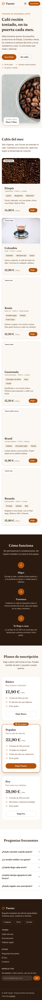
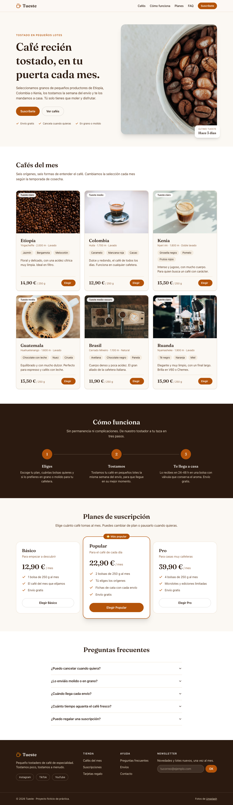

# Tueste · Laboratorio Módulo 01 (Layout + Tailwind CSS)

**Tema elegido: 🅰️ Tueste**, el tostadero de café de especialidad ficticio que vende por suscripción.

Landing page maquetada con HTML semántico y Tailwind CSS 4, mobile first.

| Móvil (375 px) | Escritorio (1280 px) |
| --- | --- |
|  |  |

## Cómo arrancarlo

```bash
npm install
npm run dev      # servidor de desarrollo con recarga
npm run build    # comprobación de tipos + build en dist/
npm run preview  # sirve la build
```

> El `.npmrc` del proyecto fija el registro público de npm por si vuestra configuración global apunta a un registro privado.

## Integración de Tailwind: Vite

Uso el plugin oficial **`@tailwindcss/vite`** (sobre el [boiler-tailwind](https://github.com/Lemoncode/boiler-tailwind) del curso):

- El proyecto ya usa Vite como servidor y bundler, así que el plugin se engancha directamente a su pipeline: no hace falta `postcss.config.js` ni ninguna configuración extra, y la recarga en caliente es inmediata.
- Es la opción que recomienda Tailwind 4 cuando el proyecto usa Vite. Es más rápida que pasar por PostCSS.
- **PostCSS** (`@tailwindcss/postcss`) tendría sentido si la herramienta de build no fuera Vite (webpack, algunos frameworks…). En v4 tampoco hace falta `autoprefixer`: Tailwind ya se encarga de los prefijos.

Toda la configuración está en el CSS (`src/style.css`): no hay `tailwind.config.js` (eso era la v3).

## Secciones

1. **Cabecera** fija con efecto cristal, logo, menú (hamburguesa en móvil) y botón "Suscríbete".
2. **Hero**: titular, texto, botón principal y secundario, imagen con etiqueta flotante y animación de entrada.
3. **Cafés del mes**: 6 tarjetas con imagen, origen, notas de cata, precio y botón.
4. **Cómo funciona**: tres pasos conectados con una línea.
5. **Planes**: Básico, Popular (destacado) y Pro.
6. **Preguntas frecuentes** con `<details>` nativo.
7. **Pie** con 4 columnas, redes, newsletter con validación y copyright.

## Checklist

### Obligatorios

- [x] **O1 Estructura semántica**: `header`, `nav`, `main`, `section` con título, `article` en las tarjetas, `footer`; un solo `h1`; listas de enlaces en `ul`; `alt` descriptivo en el hero y `alt=""` en las fotos decorativas.
- [x] **O2 Tema con `@theme`**: marca `cafe` (500/700/900) + fondos `crema` (50/100/200) + acento `tostado` (500/600/700); tipografía Fraunces (Google Fonts) para los títulos. Ningún color "a pelo" en el HTML.
- [x] **O3 Cabecera con flexbox**: `flex items-center justify-between gap-*`; enlaces con `hover:` y `focus-visible:`.
- [x] **O4 Hero**: una columna en móvil, `md:grid-cols-2` desde `md` (grid porque son dos bloques que se reparten el ancho a partes iguales y se alinean en vertical con `items-center`); texto limitado a `max-w-[45ch]`.
- [x] **O5 Rejilla de tarjetas**: 6 tarjetas, `grid grid-cols-1 sm:grid-cols-2 lg:grid-cols-3 gap-6`, `aspect-3/2 object-cover`, hover con sombra y `-translate-y-1`.
- [x] **O6 Pasos con flexbox**: `flex flex-col md:flex-row`, contenido centrado con `flex flex-col items-center justify-center`.
- [x] **O7 Pie**: 4 columnas en escritorio que se apilan en móvil, copyright separado con `border-t`.
- [x] **O8 Accesibilidad**: todo usable con teclado y con foco visible, enlace "Saltar al contenido", contraste revisado, nada de texto en imágenes. **Lighthouse Accesibilidad: 100** (ver abajo).
- [x] **O9 README + bitácora de IA** (este fichero).

### Opcionales

- [ ] P1 · Modo oscuro
- [x] **P2 · Cabecera fija con efecto cristal**: `sticky top-0 z-20 backdrop-blur bg-crema-50/90` (explicación abajo).
- [x] **P3 · Planes con tarjeta destacada**: borde de color, `md:scale-105` y etiqueta "⭐ Más popular" con `absolute` sobre un padre `relative`.
- [x] **P4 · FAQ plegable sin JavaScript**: `<details>`/`<summary>` + `group-open:rotate-180`; con `name="faq"` solo se abre una a la vez.
- [x] **P5 · Formulario con estados**: `label` asociado, estilos `focus:`, `user-invalid:` y `disabled:`, mensaje de error con `peer` + `peer-user-invalid:block`.
- [ ] P6 · Bento grid
- [x] **P7 · Animaciones con cabeza**: transiciones en botones y tarjetas, zoom de la imagen con `group-hover:`, animación propia `animate-aparecer` en el hero (definida en `@theme`); todo lo que se mueve va con `motion-safe:`.

### Desafíos

- [ ] D1 · Menú hamburguesa sin JavaScript. Hay menú hamburguesa, pero usa unas líneas de JS (cambia `aria-expanded`; el CSS muestra el menú con `peer-aria-expanded:flex`).
- [ ] D2 · Container queries
- [ ] D3 · Multitema
- [ ] D4 · Utilidades propias con `@utility` (por ahora los botones son componentes en `@layer components`).
- [ ] D5 · Layout de aplicación
- [ ] D6 · De captura a código
- [x] **D7 · Lighthouse**: Accesibilidad, Buenas prácticas y SEO a 100; Rendimiento 95 (móvil) / 98 (escritorio).

## Lighthouse

Medido sobre la build (`npm run build && npm run preview`):

| Modo | Rendimiento | Accesibilidad | Buenas prácticas | SEO |
| --- | --- | --- | --- | --- |
| Móvil | 95 | **100** | 100 | 100 |
| Escritorio | 98 | **100** | 100 | 100 |

Lo que ayuda al rendimiento: `width`/`height` en todas las `` (no hay saltos al cargar), `loading="lazy"` en las tarjetas, `fetchpriority="high"` y `srcset` en la imagen del hero, e imágenes de Unsplash pedidas al tamaño justo (`?w=600&h=400&fit=crop`).

## Por qué `sticky` y no `fixed`, y por qué el `z-index` (P2)

- **`sticky`** se comporta como un elemento normal hasta que llega a `top: 0` y entonces se queda pegado. **Sigue ocupando su sitio en el flujo**, así que el hero empieza justo debajo de la cabecera. Con **`fixed`** la cabecera sale del flujo: el contenido se metería por debajo y habría que compensarlo a mano con un `padding-top` del mismo alto que la cabecera.
- **`z-index`**: al hacer scroll, el contenido pasa por debajo de la cabecera. Varias piezas de ese contenido están posicionadas o crean su propio contexto de apilamiento (la etiqueta del hero con `absolute`, las tarjetas con `translate` al hacer hover, la tarjeta destacada con `scale`). Como van **después** en el HTML, se pintarían **encima** de la cabecera. `z-20` sube la cabecera por encima de todas. Uso una escala pequeña: cabecera 20, enlace de salto 30.
- **Efecto cristal**: `bg-crema-50/90` (fondo al 90 %) + `backdrop-blur` (desenfoca lo que pasa por detrás).

## Decisiones

- **Utilidades de Tailwind en lugar de componentes DaisyUI**, para que cada decisión de layout (flex, grid, posicionamiento) quede a la vista.
- **Capas**: estilos base de títulos y foco en `@layer base`; los botones, que se repiten mucho, en `@layer components` (`.btn`, `.btn-primario`, `.btn-secundario`). Al estar en capas, cualquier utilidad del HTML los sobrescribe (`btn px-4 py-2`).
- **El estado vive en atributos**: el menú usa `aria-expanded` + `peer-aria-expanded:`, el FAQ el atributo `open` + `group-open:` y el formulario `:user-invalid` + `peer-user-invalid:`. El JS no toca clases.
- **Foco visible global**: `:focus-visible` con `outline-current` en la capa base. Se sobrescribe donde el color del texto no contrasta con el fondo de alrededor (botones naranjas, enlace de salto).

En [`NOTAS.md`](./NOTAS.md) explico cada clase que no es evidente y con qué lección del módulo se relaciona.

## Comprobaciones

- 375 px, 768 px y 1280 px sin scroll horizontal.
- Recorrido completo con Tab: el foco siempre se ve; Escape cierra el menú móvil.
- Probado con "Emulate CSS prefers-reduced-motion: reduce": no hay animaciones de entrada ni desplazamientos.
- HTML validado con `html-validate`.
- `npm run build` sin errores.

## 🤖 Bitácora de IA

**Herramienta:** Claude Code (agente en el terminal), con el temario del módulo como contexto. Le pedí primero un resumen del temario y un plan por secciones, y después la implementación. Las capturas y las comprobaciones (ancho, teclado, formulario, Lighthouse) se hicieron con Chrome headless.

### 1 · Revisar contra el enunciado

#### Prompt

"Implementa el plan" (el plan se hizo a partir del boceto del enunciado, sin la lista de requisitos). La corrección llegó después, con el prompt: "Se me olvidó pegar los requisitos: ¿están todos los obligatorios? Quiero añadir un par de opcionales." (con la lista de requisitos del enunciado)

#### Qué me dio

Una landing completa, pero con **3 tarjetas** de café que usaban un enlace de texto "Elegir →" como acción, y la sección de pasos maquetada con **grid** (`grid md:grid-cols-3`).

#### Qué corregí y por qué

Al repasar la lista de obligatorios: O5 pide **al menos 6 tarjetas** con **botón** y hover con `-translate-y-1`, y O6 pide **flexbox** (`flex flex-col md:flex-row`). Añadí tres orígenes más, cambié el enlace por un botón y pasé los pasos a flex con `flex-1`, para que los tres midan lo mismo y la línea de unión (calculada con `calc()` sobre el ancho de cada paso) siga encajando.

### 2 · El foco invisible del enlace de salto

#### Prompt

"Implementa el plan". El plan incluía una fase de comprobación: 375/768/1280 px, recorrido con Tab y foco visible.

#### Qué me dio

Un estilo global `:focus-visible { outline-current }` (el anillo de foco toma el color del texto). Funcionaba casi en todo, pero el enlace "Saltar al contenido" tiene texto crema sobre una píldora oscura, así que su anillo era **crema sobre el fondo crema de la página**, invisible.

#### Qué corregí y por qué

`focus-visible:outline-cafe-900` en ese enlace. `currentColor` contrasta con el fondo **del propio elemento**, pero con `outline-offset` el anillo se pinta **fuera**, sobre el fondo de alrededor. Por el mismo motivo los botones naranjas llevan su propio color de anillo.

### 3 · "La build pasa" no significa que esté bien

#### Prompt

"Se me olvidó pegar los requisitos: ¿están todos los obligatorios? Quiero añadir un par de opcionales." (con la lista de requisitos del enunciado)

#### Qué me dio

Para no repetir a mano el HTML de las tarjetas, generó las 6 con un script que sustituía el bloque antiguo buscando el `</ul>` de cierre. Pero ese texto también aparece dentro de cada tarjeta (la lista de notas de cata), así que cortó demasiado pronto y **dejó restos de las tarjetas antiguas**: 8 tarjetas, dos de ellas duplicadas. La build terminaba sin errores.

#### Qué corregí y por qué

Lo detectó una comprobación que contaba los `article` de la sección. Borré el bloque sobrante y validé el HTML. Lección: igual que dice el tema 22, que la build termine bien no demuestra nada; hay que mirar el resultado.

### 4 · `aria-label` donde no toca

#### Prompt

"Se me olvidó pegar los requisitos: ¿están todos los obligatorios? Quiero añadir un par de opcionales." (con la lista de requisitos del enunciado) Antes de entregar le pedí al agente que validara el HTML.

#### Qué me dio

Había puesto `aria-label="Notas de cata"` y `aria-label="Redes sociales"` en `<ul>` normales.

#### Qué corregí y por qué

Los quité: `aria-label` en una lista sin rol interactivo no aporta nada (muchos lectores de pantalla lo ignoran) y el validador lo marca. Las notas se entienden por sí solas y las redes ya están bajo su columna del pie.

### 5 · SEO 92 en Lighthouse

#### Prompt

"Se me olvidó pegar los requisitos: ¿están todos los obligatorios? Quiero añadir un par de opcionales." (con la lista de requisitos del enunciado) O8 pide apuntar la nota de Lighthouse.

#### Qué me dio

Accesibilidad y Buenas prácticas a 100, pero SEO a 92 por un `robots.txt` "inválido": no existía, y el servidor devolvía el `index.html` en su lugar.

#### Qué corregí y por qué

Añadí `public/robots.txt` (Vite copia `public/` tal cual a la raíz) → SEO 100.

## Créditos

- Fotos de [Unsplash](https://unsplash.com/); iconos de [Lucide](https://lucide.dev/); tipografía [Fraunces](https://fonts.google.com/specimen/Fraunces).
- Proyecto ficticio de práctica.
