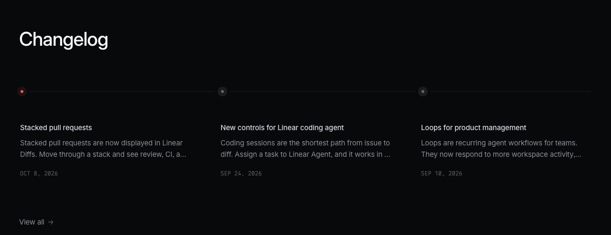
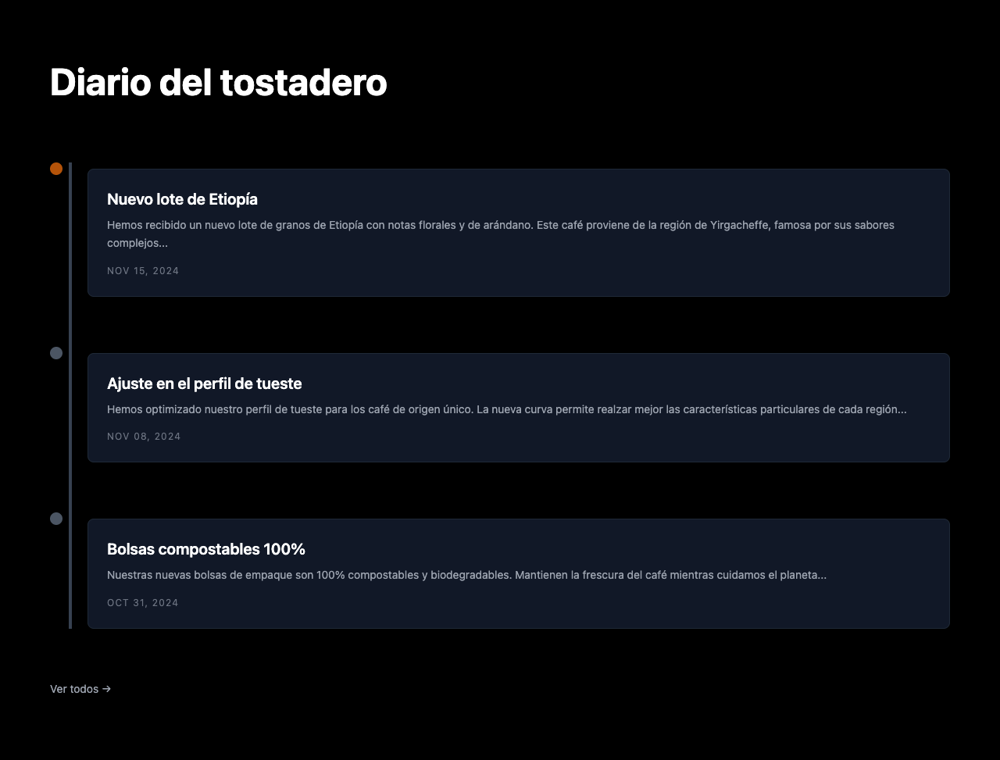
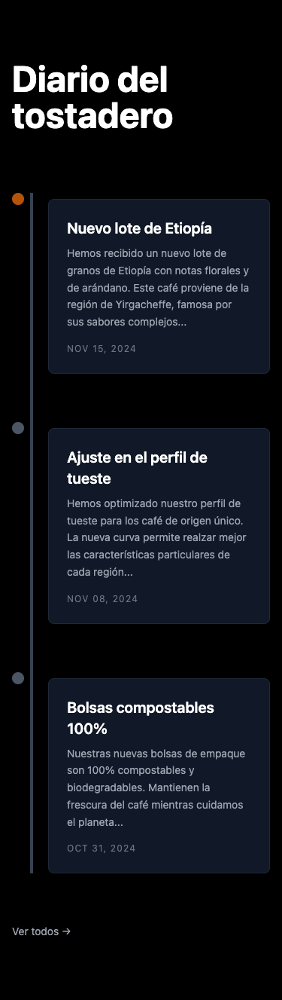
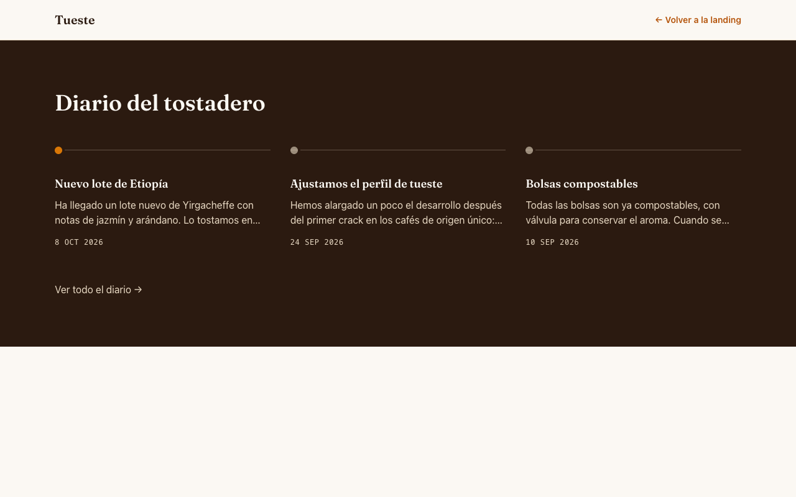
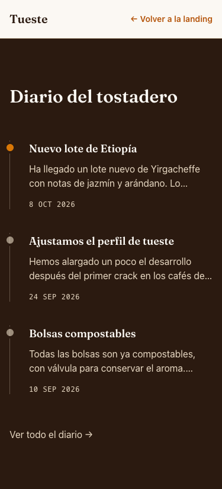

# D6 · De captura a código (y mejorarlo)

## La captura

La sección **"Changelog"** de la home de [linear.app](https://linear.app/) (captura tomada en octubre de 2026, solo como referencia de diseño): una línea de tiempo horizontal con tres entradas, cada una con su punto, título, texto recortado y fecha.

## El prompt

Le pasé la captura a otro agente de IA (Claude, modelo pequeño, sin acceso al resto del proyecto, como si la pegara en un chat) con este prompt:

> Maqueta esta sección en HTML con Tailwind CSS. Es para la web de un tostadero de café llamado "Tueste": en vez de "Changelog", la sección se llama "Diario del tostadero" y las tres entradas hablan del café (por ejemplo: nuevo lote de Etiopía, cambio en el tueste, nueva bolsa compostable), con sus fechas.

## Antes y después

| | Fichero | Escritorio | Móvil |
| --- | --- | --- | --- |
| **Antes** (lo que dio la IA, sin tocar) | [`antes.html`](antes.html) |  |  |
| **Después** (revisado a mano) | [`despues.html`](despues.html) |  |  |

`antes.html` se abre directamente en el navegador (carga Tailwind desde el CDN). `despues.html` forma parte del proyecto: `npm run dev` → `/d6/despues.html`.

## Qué cambié y por qué

Lo medido con axe-core y con las DevTools está marcado con 📏.

| # | Problema en el "antes" | Qué hice | Tema |
| --- | --- | --- | --- |
| 1 | **No se parece a la captura**: la captura es una línea de tiempo **horizontal** de 3 columnas; la IA hizo una vertical con tarjetas. | `grid md:grid-cols-3`: horizontal desde `md`; en móvil, vertical (no caben tres columnas). | 20, 21 |
| 2 | 📏 **Los puntos no están sobre la línea**: la línea está en `left-6` y los puntos en otra columna flex; quedan 18 px desplazados. | La línea es el **borde** de cada `li` (`border-l` en móvil, `md:border-t` en escritorio) y el punto un `absolute` centrado sobre ese borde (`-left-1.5` con `size-3`: −0.375rem + 0.75rem/2 = 0). | 06, 17 |
| 3 | 📏 Carga Tailwind con `<script src="https://cdn.tailwindcss.com">`: el propio CDN avisa en consola de que **no es para producción**, y no usa nuestro `@theme`. | Usa el CSS del proyecto (Vite + `@tailwindcss/vite`). | 22 |
| 4 | **Colores a pelo de la paleta por defecto** (`bg-black`, `bg-gray-900`, `bg-amber-700`…). | Tokens del tema (`bg-marca-900`, `text-claro-200`, `bg-acento-500`): funciona con los tres temas y el modo oscuro. | 05, O2 |
| 5 | 📏 **Contraste insuficiente** en las fechas: `text-gray-500` sobre `bg-gray-900` = **3,66:1** (mínimo 4,5:1). | `text-claro-200` sobre `bg-marca-900` (> 10:1). | O8 |
| 6 | **Sopa de `div`**: las entradas son `div`; el título de la sección es `h1`; 📏 axe marca orden de títulos incorrecto y contenido fuera de landmarks. | `section` + `h2` (en la landing ya hay un `h1`), `ol > li > article` (es una lista **ordenada** por fecha), `h3` por entrada, todo dentro de `main`. | 01 |
| 7 | Fechas como texto, en formato inglés (`NOV 15, 2024`) y de hace dos años. | `<time datetime="2026-10-08">8 oct 2026</time>`: legible por máquinas y en español. | 01 |
| 8 | El texto se recorta escribiendo **"..." a mano**: el resto del texto se pierde (también para lectores de pantalla). | Texto completo + `line-clamp-2`: se recorta visualmente, pero el texto entero sigue en el HTML. | 06 |
| 9 | `flex-shrink-0`: **nombre antiguo**. Desde Tailwind 3 la clase se llama `shrink-0`; v4 todavía genera la antigua por compatibilidad (lo comprobé con el compilador de la 4.1.17), pero la documentación actual ya no la usa. Pista típica de que la IA ha aprendido de código viejo. | Ya no hace falta: el punto es `absolute`. Donde sí hace falta (iconos de los planes) uso `shrink-0`. | 22 |
| 10 | `min-h-screen` en una sección que no tiene por qué ocupar la pantalla entera. | Fuera: la sección mide lo que su contenido + `py-20`. | 05 |
| 11 | La línea decorativa es un `div` vacío con un ancho mágico. Enlace "Ver todos →" sin contexto y con la flecha leída en voz alta. | El punto lleva `aria-hidden="true"`; el enlace dice "Ver todo el diario" y la flecha va en un `span aria-hidden`. Foco visible heredado del estilo base. | 12, O8 |
| 12 | Textos genéricos ("cuidamos el planeta"), alguna errata ("para los café"). | Textos concretos y revisados. | — |

Resultado: el "después" pasa axe sin errores (WCAG A/AA), no tiene scroll horizontal a 375 px y cambia con el tema y el modo oscuro como el resto de la web.
